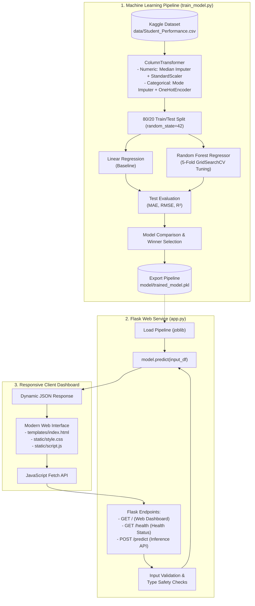

# EduPredict – Student Academic Performance Prediction System

An end-to-end Machine Learning web application designed to forecast a student's continuous **Performance Index (10 – 100)** based on key study habits, past academic records, practice exam consistency, and healthy lifestyle routines.

---

## 📋 Table of Contents
1. [Project Overview](#-project-overview)
2. [Dataset Information](#-dataset-information)
3. [System Architecture](#-system-architecture)
4. [Machine Learning Methodology](#-machine-learning-methodology)
5. [Evaluation Metrics & Results](#-evaluation-metrics--results)
6. [Project Directory Structure](#-project-directory-structure)
7. [Local Setup & Execution Guide (Windows)](#-local-setup--execution-guide-windows)
8. [REST API Documentation](#-rest-api-documentation)
9. [Docker Deployment Guide](#-docker-deployment-guide)
10. [Automated Testing Suite](#-automated-testing-suite)
11. [Engineering Challenges & Solutions](#-engineering-challenges--solutions)
12. [Future Improvements](#-future-improvements)

---

## 🎓 Project Overview

Predicting student academic outcomes early allows educators and academic counselors to provide timely, personalized interventions. **EduPredict** implements an end-to-end data science lifecycle:
- Ingests and cleans student academic data.
- Enforces strict preprocessing guardrails to prevent data leakage.
- Trains, evaluates, and hyperparameter-tunes regression models.
- Exports the best-performing pipeline into a deployable artifact.
- Serves predictions via a high-performance Flask REST API.
- Delivers an intuitive, responsive student dashboard frontend (HTML5, CSS3, JavaScript).
- Encapsulates the application in Docker for reproducible deployment.

---

## 📊 Dataset Information

- **Dataset Source:** [Student Performance Multiple Linear Regression (Kaggle)](https://www.kaggle.com/datasets/nikhil7280/student-performance-multiple-linear-regression)
- **Target File Location:** `data/Student_Performance.csv`
- **Number of Records:** 10,000 students

### Input Features & Target Variable

| Feature Name | Data Type | Value Range / Values | Description |
| :--- | :--- | :--- | :--- |
| **Hours Studied** | Numeric (Float) | $0.0 - 24.0$ (typically $1 - 9$) | Daily hours dedicated to study. |
| **Previous Scores** | Numeric (Float) | $0.0 - 100.0$ | Average score achieved in previous examinations. |
| **Extracurricular Activities** | Categorical | `Yes` or `No` | Participation in school clubs, sports, or arts. |
| **Sleep Hours** | Numeric (Float) | $0.0 - 24.0$ (typically $4 - 9$) | Average daily hours of sleep. |
| **Sample Question Papers Practiced** | Numeric (Integer) | $\ge 0$ (typically $0 - 9$) | Number of practice/mock question papers solved. |
| **Performance Index** *(Target)* | Numeric (Float) | $10.0 - 100.0$ | Continuous target metric measuring overall academic performance. |

---

## 🏛 System Architecture

The following diagram illustrates the end-to-end architecture from data ingestion to user interaction:



---

## ⚙️ Machine Learning Methodology

### 1. Preprocessing Pipeline (`ColumnTransformer`)
To prevent data leakage, all imputation and feature transformations are wrapped inside a scikit-learn `Pipeline`:
- **Numerical Features** (`Hours Studied`, `Previous Scores`, `Sleep Hours`, `Sample Question Papers Practiced`):
  - `SimpleImputer(strategy='median')`: Handles missing values using the median.
  - `StandardScaler()`: Standardizes features by removing the mean and scaling to unit variance.
- **Categorical Feature** (`Extracurricular Activities`):
  - `SimpleImputer(strategy='most_frequent')`: Replaces missing entries with the mode.
  - `OneHotEncoder(drop='first', handle_unknown='ignore')`: Converts binary responses to numeric representation ($0$ for No, $1$ for Yes) without introducing multicollinearity.

### 2. Models & Hyperparameter Tuning
- **Baseline Model:** `LinearRegression()` provides an interpretable benchmark.
- **Ensemble Model:** `RandomForestRegressor(random_state=42)` tuned strictly on training data using 5-fold cross-validation (`GridSearchCV`):
  - `regressor__n_estimators`: `[50, 100]`
  - `regressor__max_depth`: `[None, 10, 20]`
  - `regressor__min_samples_split`: `[2, 5]`
  - Scoring: $R^2$ score across folds.

---

## 📈 Evaluation Metrics & Results

Model performance is evaluated on the held-out 20% test dataset using three standard regression metrics:

1. **Mean Absolute Error (MAE):**
   $$\text{MAE} = \frac{1}{n} \sum_{i=1}^{n} |y_i - \hat{y}_i|$$
2. **Root Mean Squared Error (RMSE):**
   $$\text{RMSE} = \sqrt{\frac{1}{n} \sum_{i=1}^{n} (y_i - \hat{y}_i)^2}$$
3. **Coefficient of Determination ($R^2$):**
   $$R^2 = 1 - \frac{\sum_{i=1}^{n} (y_i - \hat{y}_i)^2}{\sum_{i=1}^{n} (y_i - \bar{y})^2}$$

### Dynamic Evaluation Output
When `train_model.py` is executed with the Kaggle dataset, actual values are computed dynamically and output to the terminal:

```text
======================================================================
             MODEL EVALUATION RESULTS (HELD-OUT TEST SET)             
======================================================================
Metric                         | Linear Regression | Random Forest (Tuned)
----------------------------------------------------------------------
Mean Absolute Error (MAE)      | 1.6111            | 1.7275           
Root Mean Squared Error (RMSE) | 2.0206            | 2.1691           
R-squared (R^2 Score)          | 0.9890            | 0.9873           
======================================================================
```

- **Cross-Validation Tuning Results:** 5-fold `GridSearchCV` on Random Forest identified optimal hyperparameters: `max_depth = 10`, `min_samples_split = 5`, `n_estimators = 100` (Best CV $R^2 = 0.9863$).
- **Top Model Winner:** **Linear Regression** achieved the highest generalization score on the held-out test set ($R^2 = 0.9890$, $\text{RMSE} = 2.0206$, $\text{MAE} = 1.6111$).
- **Exported Pipeline:** Saved to `model/trained_model.pkl` and `models/best_model_pipeline.joblib`.

---

## 📂 Project Directory Structure

```text
EduPredict/
│
├── data/
│   ├── .gitkeep
│   ├── README.md                      # Guide on placing the Kaggle CSV
│   └── Student_Performance.csv       # Place Kaggle CSV here (git-ignored)
│
├── model/
│   ├── .gitkeep
│   └── trained_model.pkl              # Primary serialized ML pipeline
│
├── models/
│   ├── .gitkeep
│   └── best_model_pipeline.joblib     # Secondary export artifact from training
│
├── static/
│   ├── style.css                      # Modern responsive styling (lavender/purple/pink)
│   └── script.js                      # Client controller (Fetch API, validation, UI)
│
├── templates/
│   └── index.html                     # Frontend dashboard HTML template
│
├── tests/
│   └── test_app.py                    # Unit and integration test suite (13 test cases)
│
├── .dockerignore                      # Docker build exclusions
├── .gitignore                         # Git version control exclusions
├── Dockerfile                         # Container build configuration
├── pytest.ini                         # Pytest test runner configuration
├── requirements.txt                   # Pinned application dependencies
├── train_model.py                     # Machine Learning training & tuning script
├── app.py                             # Flask backend web application
└── README.md                          # Project documentation
```

---

## 💻 Local Setup & Execution Guide (Windows)

Follow these steps in **Windows PowerShell**:

### 1. Open PowerShell in the Project Directory
```powershell
cd "c:\Users\HP\OneDrive\Desktop\EduPredict"
```

### 2. Create and Activate a Virtual Environment
```powershell
python -m venv .venv
.\.venv\Scripts\Activate.ps1
```
*(If script execution is disabled on your system, run `Set-ExecutionPolicy -ExecutionPolicy RemoteSigned -Scope CurrentUser` once).*

### 3. Install Required Dependencies
```powershell
pip install -r requirements.txt
```

### 4. Download and Place the Dataset
1. Visit [Kaggle: Student Performance Multiple Linear Regression](https://www.kaggle.com/datasets/nikhil7280/student-performance-multiple-linear-regression).
2. Download `Student_Performance.csv`.
3. Place the file inside your `data/` directory:
   ```text
   c:\Users\HP\OneDrive\Desktop\EduPredict\data\Student_Performance.csv
   ```

### 5. Train the Machine Learning Models
```powershell
python train_model.py
```
This script loads the data, trains both algorithms, executes 5-fold cross-validation tuning, prints the side-by-side evaluation table, and serializes the winning pipeline to `models/best_model_pipeline.joblib`. (You may also copy/save it to `model/trained_model.pkl`).

### 6. Run the Automated Test Suite
```powershell
pytest -v
```

### 7. Launch the Web Application
```powershell
python app.py
```
Open your web browser and navigate to: **`http://127.0.0.1:5000/`**

---

## 🌐 REST API Documentation

### 1. `GET /`
- **Description:** Serves the interactive student prediction dashboard.
- **Response:** `200 OK` (HTML document).

---

### 2. `GET /health`
- **Description:** Returns real-time health and model availability status.
- **Response (`200 OK`):**
  ```json
  {
    "model_loaded": true,
    "model_path": "C:\\Users\\HP\\OneDrive\\Desktop\\EduPredict\\model\\trained_model.pkl",
    "service": "EduPredict Backend",
    "status": "healthy"
  }
  ```

---

### 3. `POST /predict`
- **Description:** Accepts 5 student input parameters, performs validation, and returns the dynamically predicted Performance Index.
- **Request Headers:** `Content-Type: application/json`
- **Request Body Example:**
  ```json
  {
    "hours_studied": 7.0,
    "previous_scores": 85.0,
    "extracurricular_activities": "Yes",
    "sleep_hours": 7.5,
    "sample_question_papers_practiced": 5
  }
  ```
  *(Note: Original dataset column names such as `"Hours Studied"` and `"Previous Scores"` are also supported).*

- **Success Response (`200 OK`):**
  ```json
  {
    "status": "success",
    "prediction": 86.42,
    "performance_index": 86.42,
    "inputs": {
      "Hours Studied": 7.0,
      "Previous Scores": 85.0,
      "Extracurricular Activities": "Yes",
      "Sleep Hours": 7.5,
      "Sample Question Papers Practiced": 5.0
    }
  }
  ```

- **Validation Error Response (`400 Bad Request`):**
  ```json
  {
    "status": "fail",
    "error": "'previous_scores' must be between 0 and 100 (received: 120.0)."
  }
  ```

- **Unloaded Model Response (`503 Service Unavailable`):**
  ```json
  {
    "status": "error",
    "error": "ML model is not loaded. Please train the model and save to model/trained_model.pkl."
  }
  ```

---

## 🐳 Docker Deployment Guide

The application includes a containerization setup configured via `Dockerfile` and `.dockerignore`.

### Build Docker Image
```bash
docker build -t edupredict:latest .
```

### Run Container
```bash
docker run -d -p 5000:5000 --name edupredict-app edupredict:latest
```
Access the application at `http://localhost:5000/`.

> **Verification Note:** The `Dockerfile` and `.dockerignore` files are configured according to industry standards with healthcheck endpoints and layer-caching optimization. Local image builds on this host machine require installing the Docker Desktop engine.

---

## 🧪 Automated Testing Suite

The project includes an automated test suite executed via `pytest`. All 13 unit and integration tests pass:

```powershell
.\.venv\Scripts\pytest -v
```

### Test Case Breakdown

| Test Name | File | Description | Status |
| :--- | :--- | :--- | :--- |
| `test_health_check` | `tests/test_app.py` | Validates `GET /health` status code and JSON payload structure. | ✅ PASS |
| `test_index_page` | `tests/test_app.py` | Verifies `GET /` serves HTML and required template elements. | ✅ PASS |
| `test_static_css_served` | `tests/test_app.py` | Verifies `GET /static/style.css` is served with HTTP 200. | ✅ PASS |
| `test_static_js_served` | `tests/test_app.py` | Verifies `GET /static/script.js` is served with HTTP 200. | ✅ PASS |
| `test_validate_input_valid_snake_case` | `tests/test_app.py` | Validates input parser with snake_case keys. | ✅ PASS |
| `test_validate_input_valid_dataset_columns` | `tests/test_app.py` | Validates input parser with original dataset column names. | ✅ PASS |
| `test_validate_input_missing_field` | `tests/test_app.py` | Ensures missing required keys trigger validation errors. | ✅ PASS |
| `test_validate_input_invalid_ranges` | `tests/test_app.py` | Ensures negative hours, scores > 100, and invalid inputs fail. | ✅ PASS |
| `test_predict_non_json` | `tests/test_app.py` | Checks `400 Bad Request` when non-JSON payload is sent to `/predict`. | ✅ PASS |
| `test_predict_missing_payload` | `tests/test_app.py` | Checks `400 Bad Request` when empty JSON payload is sent. | ✅ PASS |
| `test_predict_validation_error` | `tests/test_app.py` | Checks `400 Bad Request` on invalid parameter values. | ✅ PASS |
| `test_predict_dynamic_success` | `tests/test_app.py` | Proves predictions are dynamic (never hardcoded) across inputs. | ✅ PASS |
| `test_predict_unloaded_model` | `tests/test_app.py` | Confirms graceful `503 Service Unavailable` when model is absent. | ✅ PASS |

---

## 🛠 Engineering Challenges & Solutions

1. **Preventing Data Leakage:**
   - *Challenge:* Preprocessing data before train-test splitting leaks test set distributions into training scalers.
   - *Solution:* Encapsulated imputer, scaler, and one-hot encoder components inside a Scikit-Learn `ColumnTransformer` and `Pipeline`, fitting transformations exclusively on training folds during GridSearchCV.
2. **Flexible API Schema Adaptation:**
   - *Challenge:* Frontend forms and external REST consumers often use differing naming conventions (e.g., `hours_studied` vs. `"Hours Studied"`).
   - *Solution:* Implemented a dual-key normalizer in `app.py` supporting both conventions seamlessly while maintaining strict numerical boundary validation.
3. **Graceful Startup in Un-Trained States:**
   - *Challenge:* Web applications can crash on startup if an ML binary is missing.
   - *Solution:* Implemented safe lazy-loading in `app.py` with multi-path resolution and a status reporting `/health` endpoint, returning informative HTTP 503 error messages rather than crashing the web server.

---

## 🚀 Future Improvements

1. **Model Explainability (XAI):** Integrate SHAP (SHapley Additive exPlanations) or LIME to visualize the positive and negative impact of each individual study habit on the predicted score.
2. **User Authentication & Historical Tracking:** Add student profiles using SQLite or PostgreSQL to track a student's progress over multiple semesters.
3. **Expanded Feature Engineering:** Ingest additional behavioral features such as class attendance rate, screen time, and dietary patterns.
4. **Automated CI/CD:** Implement GitHub Actions to automate linting, unit testing, and Docker container packaging upon every repository push.
